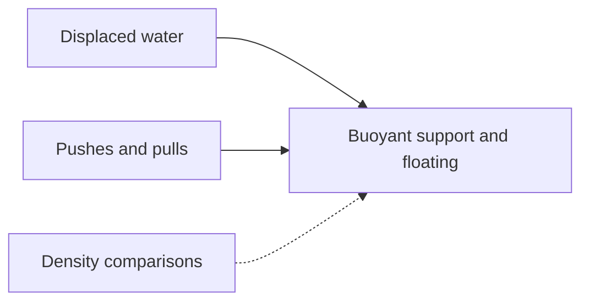

# Sparks Learning Graph

An open map of what children can learn, how ideas connect, and ways to teach and assess them. For educators, parents, researchers and developers building learning tools.

Built on **[Marble Skill Taxonomy](https://github.com/withmarbleapp/os-taxonomy)**, created by [Marble](https://withmarble.com). We extended it while developing Sparks & Sprockets, a game about building machines and understanding how they work. The graph can be used independently of the game.

**1,927 topics · 4,046 prerequisite connections · 1,927 teaching records**

[Download the graph](https://github.com/ckoglmeier/sparks-learning-graph/releases) · [US educator guide](docs/us-educator-guide.md) · [Data format](docs/data-format.md)

The `main` branch contains this 1,927-topic update. The tagged **v0.1.0-rc.1** download contains the earlier 1,922-topic version. Clone `main` for the latest data.

## See the connections

What helps a child understand why something floats? Here are a few of its recorded connections:



Arrows run from a supporting idea to the topic it helps explain. Solid lines are required prerequisites in this graph; the dotted line is helpful background. For floating, comparing weight with displaced water need not depend on knowing the word *density*.

This example shows a few connections. It is not a complete teaching sequence. An interactive 3D explorer is in development; it is not part of the published release yet.

## What Sparks adds

We preserve Marble’s 1,912 original topics and add **fifteen concepts** across practical engineering, navigation, music and French:

| Question to explore | Added concepts |
| --- | --- |
| Why does it float? | Shape and floating, density, displacement, buoyancy and liquid pressure |
| How does a machine respond? | Sensors, controllers and actuators; feedback |
| What changes when you change the design? | Force and travel in simple machines, load placement and tipping, contact pressure, and solar-panel orientation |
| How do I keep my bearings? | Using a compass to find directions |
| How long does a sound—or a silence—last? | Sound and silence durations against a pulse |
| What did I hear or read in French? | Sentence listening and spelling–sound decoding |

The [concept guide](docs/concepts.md) explains each addition and its sources. Eight earlier computing teaching guides are also preserved as [historical supplements](docs/reconciliation.md).

Our [US educator guide](docs/us-educator-guide.md) offers starting points for grades 3–5 and 6–8. The [standards comparison](docs/us-crosswalk.json) explains where a topic contributes, where it provides background, and where a standard excludes it. A curriculum reference does not establish full standards coverage or measured learning. See the [curriculum notes](docs/curriculum-alignment.md) for the detailed limits.

Game worlds, levels and unlock paths are not part of this reusable graph.

## What’s inside

The repository contains the complete JSON dataset, not just our additions.

| File | What you can find |
| --- | --- |
| [topics.json](data/topics.json) | Concepts, descriptions, approximate ages and evidence of understanding |
| [dependencies.json](data/dependencies.json) | Prerequisite connections, their strength and the reason for each |
| [teaching-research.json](data/teaching-research.json) | Teaching suggestions, activities, assessment guidance, sources and limitations, joined by topic ID |
| [clusters.json](data/clusters.json) | Summaries of related topics by subject, domain and age band |
| [curriculum-alignments.json](data/curriculum-alignments.json) | Curriculum references and suggested age ranges |
| [curriculum-standards.json](data/curriculum-standards.json) | 8,721 curriculum identifiers, with source details and links; full standards text omitted |
| [additions.json](extensions/sparks/additions.json) | The complete Sparks additions |

[UPSTREAM.json](UPSTREAM.json) identifies the source snapshot. [RELEASE-MANIFEST.json](RELEASE-MANIFEST.json) records distributed file hashes. Teaching suggestions are proposals, not tested learning interventions; read their constraints alongside the activities.

## Use it

Download and extract a [release](https://github.com/ckoglmeier/sparks-learning-graph/releases), or clone this repository. Reading the JSON needs no service or account.

Run this Python example from the repository root to find the ideas supporting buoyancy:

```python
import json
from pathlib import Path

root = Path("data")
topics = json.loads((root / "topics.json").read_text(encoding="utf-8"))["topics"]
edges = json.loads((root / "dependencies.json").read_text(encoding="utf-8"))["dependencies"]
by_id = {topic["id"]: topic for topic in topics}

buoyancy_id = "mt_0124c7499b7c49de"
for edge in edges:
    if edge["topicId"] == buoyancy_id:
        prerequisite = by_id[edge["prerequisiteId"]]
        print(f"{prerequisite['name']} ({edge['strength']}): {edge['reason']}")
```

Each `topicId` **depends on** its `prerequisiteId`. To find what a concept supports next, filter by `prerequisiteId` instead. Teaching records use `topicId` to connect guidance to the same concepts.

To check the package, use Python 3.9 or later:

```sh
python3 -m pip install -r requirements-dev.txt
python3 tools/verify_release.py
python3 -m unittest discover -s tools -p 'test_*.py'
python3 extensions/sparks/verify.py
```

See [validation](docs/validation.md) for what these checks establish and [contributing](CONTRIBUTING.md) for proposing changes.

## Licensing and attribution

| Material | License |
| --- | --- |
| Database structure and relationships | [ODbL 1.0](LICENSE) |
| Marble- and Sparks-authored learning content | [CC BY-SA 4.0](LICENSE-CONTENT) |
| Original verification tools | [MIT](LICENSE-CODE) |

These licenses permit reuse, including commercial reuse, subject to their terms. Retain attribution, identify changes and follow the applicable share-alike requirements.

**Third-party sources retain their own rights.** The curriculum catalogue omits standard-text payloads. Inherited teaching research may retain short quotations or paraphrases subject to their source terms. No special publisher permission, certification or endorsement is claimed. Read [source-rights disclosures](docs/reuse-and-licensing.md) and [provenance](PROVENANCE.md) before reuse.

> Marble Skill Taxonomy (v1) · © Generative Spark, Inc. (Marble) · https://withmarble.com · licensed under ODbL 1.0 (database) and CC BY-SA 4.0 (content).

Extended and maintained by Sparks & Sprockets. See [full attribution](ATTRIBUTION.md) and [citation information](CITATION.cff).

We preserve the original topic and teaching claims. [Connection review](extensions/sparks/connection-review.json) records the added links and seven corrected inherited directions, including confidence and counterarguments. Soft links are helpful background, not mandatory steps.
